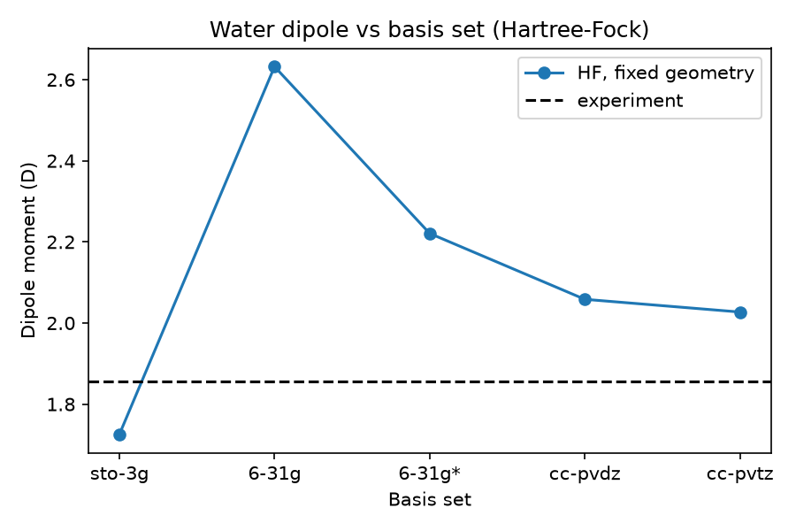
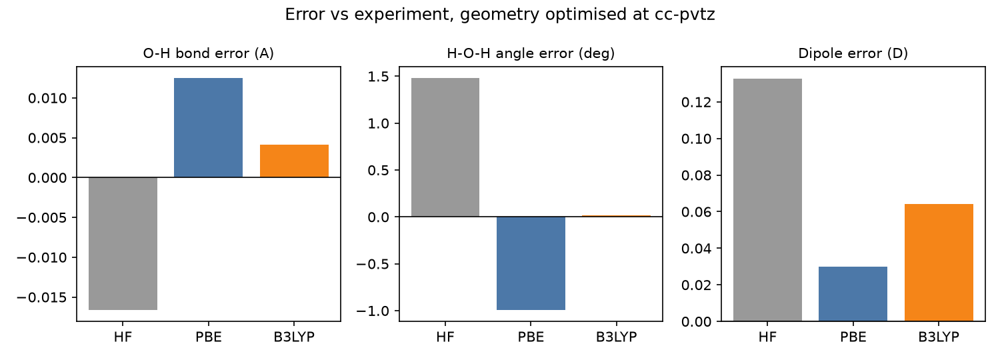

# Water benchmark: how basis set and method change computed properties

A small, reproducible PySCF study of one molecule. It asks two questions:

1. How does the **basis set** change the energy and dipole moment of water?
2. How do **Hartree-Fock (HF), PBE and B3LYP** compare with experiment for water's geometry and dipole moment, once each method has relaxed the geometry itself?

## Method

| Part | What is computed | Level of theory |
|---|---|---|
| A. Basis-set study | Energy and dipole at a fixed starting geometry | HF with STO-3G, 6-31G, 6-31G*, cc-pVDZ, cc-pVTZ |
| B. Method study | Optimised O-H bond length, H-O-H angle and dipole | HF, PBE, B3LYP, all with cc-pVTZ |

- Software: [PySCF](https://pyscf.org) for the electronic structure, [geomeTRIC](https://github.com/leeping/geomeTRIC) for geometry optimisation.
- Experimental references (gas-phase water, NIST CCCBDB): r(OH) = 0.9572 A, angle = 104.52 deg, dipole = 1.855 D.

## Results

### A. Basis-set study (HF, fixed geometry)

| basis | basis functions | energy (Eh) | energy drop (kcal/mol) | dipole (D) | dipole error (D) |
|---|---|---|---|---|---|
| sto-3g | 7 | -74.963063 | | 1.726 | -0.129 |
| 6-31g | 13 | -75.983948 | 640.6 | 2.632 | +0.777 |
| 6-31g* | 18 | -76.009099 | 15.8 | 2.221 | +0.366 |
| cc-pvdz | 24 | -76.026766 | 11.1 | 2.058 | +0.203 |
| cc-pvtz | 58 | -76.057114 | 19.0 | 2.027 | +0.172 |



### B. Method study (geometry optimised at cc-pVTZ)

| method | r(OH) (A) | error (A) | angle (deg) | error (deg) | dipole (D) | error (D) |
|---|---|---|---|---|---|---|
| HF | 0.9406 | -0.0166 | 106.00 | +1.48 | 1.988 | +0.133 |
| PBE | 0.9697 | +0.0125 | 103.53 | -0.99 | 1.885 | +0.030 |
| B3LYP | 0.9613 | +0.0041 | 104.54 | +0.02 | 1.919 | +0.064 |



## Findings

- **The minimal basis set is not good enough.** Going from STO-3G set to 6-31G set, the difference in energy is about 641 kcal/mol, far more than any chemical effect. STO-3G's dipole looks close to experiment only because errors can happen.
- **Polarisation functions matter.** Adding 5 functions in (6-31G to 6-31G*) lowered the energy by about 16 kcal/mol and cut the dipole error almost in half.
- **At the Hartree-Fock level the dipole stops improving with basis size.** It levels off near 2.0 D, about 0.17 D above experiment. The remaining error comes from the method and not from the basis set.
- **Each method has a characteristic geometry error.** HF gives bonds that are too short and an angle that is too wide. PBE gives bonds that are too long. B3LYP is closest to experiment for both the bond length and the angle.
- **For the dipole, PBE is closest in this test,** which is followed by B3LYP, and both are better than HF.

## Limitations

- This is **one molecule and one property set**, so it does not rank the methods in general. A proper benchmark would use many molecules.
- The experimental dipole is vibrationally averaged, while the computed values are for the equilibrium geometry, so differences of a few hundredths of a debye are not meaningful.
- Only the cc-pVTZ basis was used for the method comparison, and no dispersion corrections or solvent effects were included.
- Total energies from different methods are not comparable, so only properties are compared across methods.

## Reproduce

PySCF runs on Linux, macOS and WSL, but **not natively on Windows**.

```bash
conda env create -f environment.yml
conda activate water-benchmark
python benchmark.py
```

The script writes tables (`basis_study.csv`, `method_study.csv`), a markdown summary and the two figures into `results/`. It takes roughly a minute on a laptop.

## Files

- `benchmark.py` runs both studies and writes everything in `results/`
- `environment.yml` lists the conda environment
- `results/` holds the generated tables and figures
